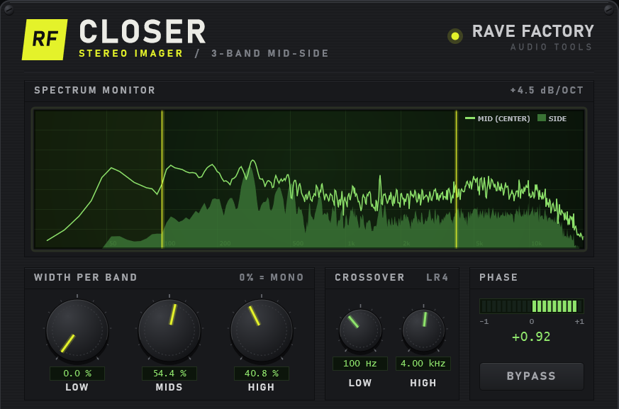

# Closer — 3-Band Stereo Imager

**Rave Factory** · VST3 · Windows · built with C++ and JUCE

Closer narrows (or keeps) the stereo width independently in three frequency bands.
It was designed for mastering, and especially for **vinyl cutting**, where wide
low frequencies cause tracking and phase problems: you can make the bass mono
without touching the stereo image of the mids and highs.

## Features

- **3-band Mid/Side width**: Low, Mids and High, each from 0 % (mono) to 100 % (original width)
- **Adjustable crossovers**: low split 40–500 Hz, high split 1–12 kHz
- **Linkwitz-Riley 24 dB/oct crossover** with allpass phase compensation, so the bands sum back flat
- **Mid channel is never processed**: the mono sum of the output is bit-identical to the input
  (verified with a polarity-inverted null test)
- **Real-time spectrum analyser** showing the Mid and the processed Side signal,
  8192-point FFT, +4.5 dB/oct slope, with the crossover points overlaid
- **Phase correlation meter** (−1 to +1), green when mono-safe and orange when out of phase
- **Click-free bypass** (20 ms crossfade), linked to the host's own bypass button
- **Rave Factory interface** drawn entirely in code: custom knobs, LCD readouts, brushed-metal panel
- Lock-free FIFO between the audio thread and the UI (no locks or allocations in `processBlock`)
- Smoothed parameters to avoid zipper noise

## How it works

1. Left/Right is converted to **Mid** `(L+R)/2` and **Side** `(L−R)/2`.
2. Only the Side signal is split into Low / Mids / High with two LR4 crossovers.
   The Low band goes through an allpass at the high crossover frequency so all
   three bands have the same phase and sum back flat.
3. Each Side band is scaled by its width control and summed back into `Side'`.
4. Output: `L = Mid + Side'`, `R = Mid − Side'`. The Mid is untouched.

## Building

1. Open `imager.jucer` in the Projucer (JUCE 9) and save it to generate the Visual Studio project.
2. Open `Builds/VisualStudio2022/Closer.sln` and build the `Closer_VST3` target.
3. Copy `Closer.vst3` to `C:\Program Files\Common Files\VST3\`.

## Roadmap

- [x] Phase 1 — single-band Mid/Side width
- [x] Phase 2 — 3-band Linkwitz-Riley crossover + null test
- [x] Phase 3 — real-time Mid/Side spectrum analyser
- [x] Phase 4 — Rave Factory interface, phase correlation meter and bypass
- [ ] Windows installer
- [ ] macOS build (VST3 + AU)

## Author

Made by a producer and mastering engineer with 30 years in the studio
and 200+ releases on digital and vinyl, now building his own tools.
